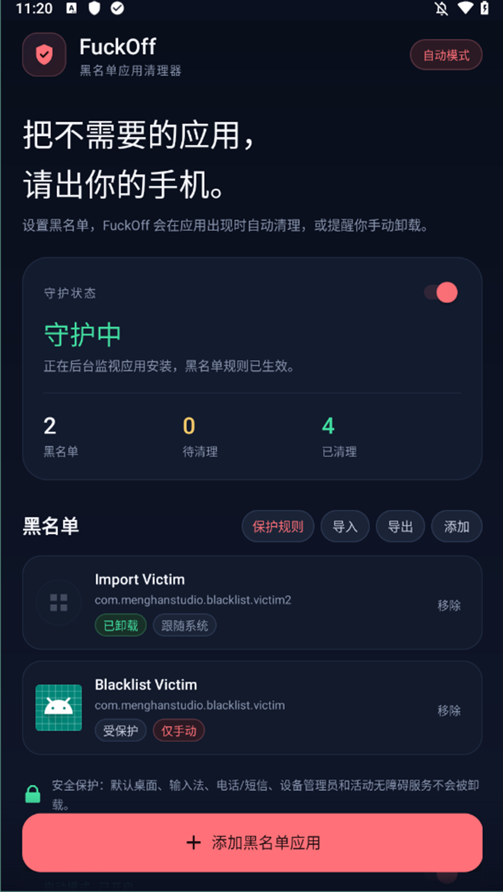
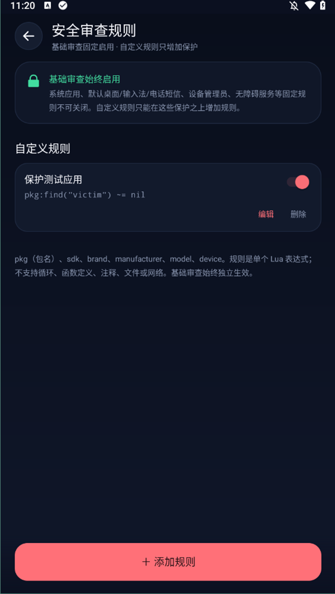
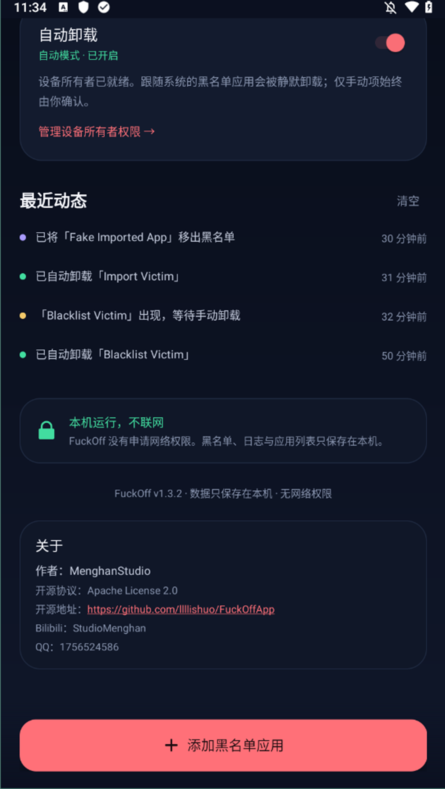

# FuckOff

> 把不需要的应用，请出你的手机。

[](LICENSE)

FuckOff 是一款 Android 黑名单应用清理器：你把自己选中的应用加入黑名单，之后只要这些应用出现在手机上，FuckOff 就会自动卸载，或在通知里提醒你手动确认卸载。

- 纯本地运行，**没有申请网络权限**
- 只处理你主动加入黑名单的**用户应用**，不会碰系统应用
- 无 root、无无障碍自动点击、无隐藏 API
- 自动模式使用 Android 官方 `PackageInstaller.uninstall` 的 **Device Owner** 能力
- 基础审查固定启用；可按 Android 版本或机型添加受限 Lua 保护规则

## 界面预览

| 首页 | 安全审查规则 |
| --- | --- |
|  |  |

> 截图使用了一条演示用测试规则；新安装的 APK 默认没有任何自定义规则，基础审查始终启用。



---

## 功能

### 黑名单

- 从已安装的用户应用中选择，可搜索名称或包名
- 黑名单持久保存在本机
- 首页展示黑名单、待清理数量、已清理次数
- 支持手动“卸载”或“移出黑名单”
- 每个黑名单项可独立选择「跟随系统」或「仅手动」；新添加项默认跟随系统
- 黑名单支持 JSON 导出 / 导入（系统文件选择器，无需存储权限）
- 安全保护：关键系统角色不会被卸载
- 安全审查规则：基础审查固定，另可添加最多 50 条 Lua 表达式规则，按包名/Android 版本/品牌等增加保护

### 两种执行模式

| 模式 | 需要什么 | 行为 |
| --- | --- | --- |
| 手动模式 | 无 | 发现黑名单应用后发出通知，点按后进入系统卸载确认界面 |
| 自动模式 | Device Owner + 通知权限（建议） | 对「跟随系统」的黑名单项静默卸载；「仅手动」项始终确认 |

> **普通 Android 应用无法静默卸载其他应用。** 自动模式必须把 FuckOff 配置成「设备所有者（Device Owner）」。这相当于企业设备管理权限，通常需要在没有账户的设备上通过 ADB 配置；很多手机需要恢复出厂设置后才能成功。无法配置时，手动模式仍然完整可用。


### 每个应用的清理方式

每个黑名单项都有独立的模式标签，点按即可切换：

| 模式 | 行为 |
| --- | --- |
| 跟随系统 | 全局自动模式开启且 Device Owner 就绪时静默卸载；否则手动确认 |
| 仅手动 | 无论全局自动模式是否开启，都只发通知，由你在系统卸载界面确认 |

- 新添加的应用默认「跟随系统」
- 从 JSON 导入的每个应用（包括同名已有项）都会设为「仅手动」
- 导入完成后**不会启动清理扫描，也不会立即卸载**；可在列表中逐项改回「跟随系统」
- 修改模式本身也不会立刻触发卸载，下一次检测/扫描或你手动点时生效

### 设备安全保护

为避免误删导致手机无法使用，以下应用会被强制保护：

- Android 系统应用和固定关键包（设置、系统界面、包安装器、权限控制器等）
- 当前默认桌面（Launcher）
- 当前默认输入法
- 默认电话、短信应用
- 活动中的设备管理员、Profile Owner
- 已启用的无障碍服务
- FuckOff 自身

它们不会出现在应用选择器里；如果通过旧数据或 JSON 出现，主页会显示「受保护」，不会发送卸载请求。黑名单同时限制为最多 200 条，避免异常数据拖垮界面。


### 自定义安全审查规则

不同 Android 版本和 OEM 的关键角色不完全相同，首页「保护规则」支持在**固定基础审查**之上追加本地规则。

- **基础审查不能被关闭**：系统应用、默认桌面/输入法/电话短信、设备管理员、无障碍服务等仍然始终生效。
- 自定义规则**只能增加保护**，没有“允许卸载”或“取消保护”的写法。
- 每条规则是一个 Lua 表达式，返回真值即视为受保护；例如：

```lua
pkg == "com.example.launcher"
pkg:match("^com%.oem%.") ~= nil
sdk >= 31 and pkg:find("keyboard") ~= nil
```

- 可用变量：`pkg`（包名）、`sdk`（Android API 级别）、`brand`、`manufacturer`、`model`、`device`。
- 为了不把规则变成可执行任意代码的入口，只支持**单个表达式**；会拒绝循环、函数定义、注释、长字符串和分号，也不提供 `os` / `io` / `package` / `load` / `luajava`。
- 最多 50 条规则，单条表达式最多 800 个字符；所有规则只保存在本机。
- 规则出错时只会跳过该规则，基础审查和 App 本身不受影响。
- 规则不包含在黑名单 JSON 的导出/导入中，需要在当前设备上单独添加。

内置 [LuaJ 3.0.1](THIRD_PARTY_NOTICES.md) 作为受限表达式求值器，没有引入网络或文件访问能力。

### 后台监控

1. 前台服务内**动态注册**的 `PACKAGE_ADDED` 广播：应用一安装就立即处理，不受 Android 8+ 对清单广播的后台限制
2. 前台服务：持续守护，通知栏可见，可一键暂停
3. `JobScheduler` 每 15 分钟兜底扫描：服务被系统回收后仍会恢复检查
4. 清单广播接收器保留为兼容性兜底；系统在部分状态下可能限制它，因此不作为唯一路径

### 删除即彻底

- 自动模式通过 `PackageInstaller.uninstall()` 卸载，应用包和应用数据都会从设备移除
- 手动模式走系统卸载界面，由 Android 再次确认
- 只针对 `FLAG_SYSTEM` 之外的用户应用；系统应用和本应用自身永远不会被加入执行队列

---

## 安装

构建产物位于本地项目根目录 `FuckOff-v1.3.3.apk`（按 `.gitignore` 规则不纳入 Git）。可通过 ADB 安装：

```bash
adb install -r FuckOff-v1.3.3.apk
```

重新构建时产物位于：

```text
app/build/outputs/apk/release/app-release.apk
```

Release APK 默认使用本机的 Android debug key 签名，方便侧载测试。正式分发前请替换为自己的 release keystore。

唯一第三方运行时依赖是 LuaJ 3.0.1（MIT，用于本地受限规则表达式），没有网络能力。

> 应用显示名已改为 **FuckOff**，但包名仍保留为 `com.menghanstudio.gooutpls`，以确保已配置的 Device Owner 和后续升级不受影响。ADB 命令中的包名不需要改变。

首次打开请允许通知权限；Android 13 及以上需要该权限才能看到后台守护和手动卸载提醒。

---

## 开启自动模式（Device Owner）

### 步骤

1. 在手机上安装 FuckOff 并打开，进入「自动卸载设置」。
2. 开启开发者选项与 USB 调试，连接电脑。
3. 电脑安装 `adb`，执行应用内展示的命令：

```bash
adb shell dpm set-device-owner com.menghanstudio.gooutpls/.admin.GoOutDeviceAdminReceiver
```

4. 回到应用点「检测权限」，状态变为「已就绪」后，打开「自动卸载」开关。

> 应用的配置页会根据当前安装包（release / debug）生成准确命令，建议直接点「复制命令」。

### 前置条件与注意

- 手机最好刚恢复出厂设置，且**没有登录任何账户、没有工作资料**
- 部分系统还要求移除锁屏密码
- 如果提示已有账户、已配置其他 Device Owner 或工作资料，通常只能恢复出厂设置后再试
- 配置前请备份数据；这是会改变设备管理状态的系统级操作
- 建议只在自己的手机或你明确负责管理的设备上使用

### 取消设备所有者

应用内进入「自动卸载设置」→「取消设备所有者权限」。取消后自动模式立即失效，手动模式仍可用。

如果应用内取消失败，可尝试恢复出厂设置，或在可调试的测试设备上使用 ADB 解除。卸载本应用前请先取消设备所有者，否则系统可能会阻止卸载。

---

## 使用

1. 点「添加黑名单应用」，搜索并勾选应用
2. 手动模式下，已安装的黑名单应用会出现在首页，可点「卸载」
3. 自动模式需要已经配置 Device Owner；开启时如果已有「跟随系统」的应用，会先弹出确认
4. 之后如果再次安装黑名单应用，按条目模式处理：「跟随系统」自动清理，「仅手动」发通知
5. 所有处理结果都在「最近动态」里

### 示例

- 把某个游戏加入黑名单，保持「跟随系统」并开启自动模式：重新安装后几秒内会被静默卸载
- 把短视频应用设为「仅手动」：即使自动模式开启，通知出现后点按并在系统界面确认才会卸载
- 导入 JSON 后：所有导入项默认为「仅手动」，不会立即清理

---

## 黑名单 JSON 备份

首页黑名单标题右侧提供「导入」「导出」。文件通过 Android 系统文件选择器读写，应用不申请存储权限。

导出格式：

```json
{
  "app": "FuckOff",
  "schema": "fuckoff.blacklist",
  "version": 1,
  "exportedAt": 1792334013758,
  "count": 1,
  "entries": [
    {
      "packageName": "com.example.app",
      "label": "示例应用",
      "addedAt": 1792334013758,
      "mode": "system"
    }
  ]
}
```

导入规则：

- 支持完整对象格式，也支持顶层数组；数组元素可以是包名字符串或包含 `packageName` / `label` / `addedAt` / `mode` 的对象
- 导入时 **mode 会被强制覆盖为 `manual`**，所有导入项默认「仅手动」
- **合并导入**，不会删除现有黑名单；重复包名会更新显示名称、添加时间并切换为「仅手动」
- 自动跳过重复项、非法包名、本应用自身和系统关键包
- 文件上限 2 MB、最多 200 条
- 导入后立即把条目设为「仅手动」，不执行自动清理
- 如果自动模式正在运行，导入框仍会说明这些条目会以「仅手动」方式存在，不会立刻卸载

如果只需要备份或迁移，建议定期导出并保存 JSON 文件。

---

## 构建

### 环境

- JDK 17
- Android SDK Platform 35
- Android Build-Tools 35.0.0
- Gradle 8.9（仓库包含 wrapper）

### 命令

```bash
# Windows
gradlew.bat assembleDebug
gradlew.bat assembleRelease

# macOS / Linux
./gradlew assembleDebug
./gradlew assembleRelease
```

产物：

```text
app/build/outputs/apk/debug/app-debug.apk
app/build/outputs/apk/release/app-release.apk
```

Debug 变体的包名是 `com.menghanstudio.gooutpls.debug`，Device Owner 命令中的包名不同；请以应用内显示的命令为准。

### 签名

`app/build.gradle` 的 release 构建目前复用 debug 签名，以便直接产生可安装 APK。正式发布时请创建自己的 keystore：

```gradle
android {
    signingConfigs {
        release {
            storeFile file("your-release.jks")
            storePassword "..."
            keyAlias "..."
            keyPassword "..."
        }
    }
    buildTypes {
        release {
            signingConfig signingConfigs.release
        }
    }
}
```

---

## 权限说明

| 权限 | 用途 |
| --- | --- |
| `QUERY_ALL_PACKAGES` | 读取已安装应用，供黑名单选择与扫描 |
| `REQUEST_DELETE_PACKAGES` | 手动卸载时打开系统卸载界面；Device Owner 自动卸载的公开 API 要求 |
| `POST_NOTIFICATIONS` | 后台守护和手动卸载提醒 |
| `FOREGROUND_SERVICE` / `FOREGROUND_SERVICE_SPECIAL_USE` | 持续监控黑名单 |
| `RECEIVE_BOOT_COMPLETED` | 重启后恢复守护与周期任务 |

**没有 `INTERNET` 权限。** 应用列表、黑名单和日志只写入本机 SharedPreferences，不会上传。

---

## 项目结构

```text
app/src/main/
├── AndroidManifest.xml
├── java/com/menghanstudio/gooutpls/
│   ├── MainActivity.java              首页、统计、日志、开关
│   ├── AppPickerActivity.java         搜索与多选已安装应用
│   ├── DeviceOwnerActivity.java       Device Owner 配置与移除
│   ├── ManualUninstallActivity.java   打开系统卸载界面的透明代理
│   ├── SafetyRulesActivity.java       自定义保护规则列表
│   ├── RuleEditActivity.java          添加/编辑受限 Lua 规则
│   ├── core/
│   │   ├── AppCatalog.java            应用可见性、系统应用过滤
│   │   ├── AppSafetyGuard.java        默认桌面/输入法/管理员等安全保护
│   │   ├── RuleEngine.java            受限 Lua 表达式求值
│   │   ├── RuleRepository.java        用户规则本地存储
│   │   ├── AppPrefs.java              设置与操作标记
│   │   ├── BlacklistRepository.java   黑名单持久化
│   │   ├── BlacklistJsonCodec.java    JSON 导入导出编解码
│   │   ├── DeviceOwnerTools.java      Device Owner 状态与取消
│   │   ├── EventRepository.java       最近动态
│   │   └── GuardEngine.java           检测与卸载决策核心
│   ├── receiver/                      包变化、开机、卸载结果、通知动作
│   ├── service/                       前台守护 + 周期任务
│   └── util/NotificationHelper.java   通知与渠道
└── res/                               UI、主题、图标
```

项目根目录另含 `LICENSE`（Apache-2.0）、`NOTICE` 和 `THIRD_PARTY_NOTICES.md`（LuaJ 3.0.1，MIT）。这些许可文本也打包在 APK 的 `assets/` 中。

### 关键实现

```java
// GuardEngine.java
PackageInstaller installer = context.getPackageManager().getPackageInstaller();
installer.uninstall(packageName, statusPendingIntent.getIntentSender());
```

`PackageInstaller.uninstall` 的文档明确允许“设备所有者（device owner）”调用；同时声明 `REQUEST_DELETE_PACKAGES`。卸载结果通过 `PendingIntent` 回传，并与 `PACKAGE_FULLY_REMOVED` 广播互相兜底。

---

## 测试状态

已在 Android 9（API 28）模拟器上完成 Device Owner、自动静默卸载、单项手动模式、自定义 Lua 规则（保存/开关/删除/按包名匹配/非法规则拒绝）、导入强制手动且不立即清理、通知手动卸载、后台安装检测、JSON 导出/导入和权限取消的端到端验证；Lint 为 0 errors。详细记录见 [TESTING.md](TESTING.md)。Android 13+ 的运行时通知权限和 Android 14+ 的 `specialUse` 前台服务仅完成代码适配，未在对应版本真机上实测。

## 已知边界

- **Device Owner 是硬门槛**：没有它就无法静默卸载第三方应用，这是 Android 的安全设计
- 只支持当前用户空间，不处理多用户/工作资料里的应用
- 系统应用、预装应用不会显示在黑名单选择器中
- 某些 OEM 会限制后台启动或杀前台服务；`JobScheduler` 作为兜底，但极端省电策略仍可能延迟处理
- 用户手动“强行停止”应用后，监控会暂停，直到再次打开应用；这是 Android 的系统行为
- 目标应用如果自身是活动设备管理员，系统可能拒绝卸载，需要先在系统设置中取消其设备管理员
- 自定义规则是受限 Lua 表达式，不是完整 Lua；需要循环、函数或文件访问的复杂逻辑请使用宿主机脚本生成包名后添加简单规则
- 不提供远程管理、云同步或家长控制服务器；这是本地工具

---

## 隐私

- 无网络权限、无分析 SDK、无广告
- 不收集设备标识、位置、通讯录或使用记录
- 所有数据可通过清除应用数据删除

## 许可

本项目采用 **[Apache License 2.0](LICENSE)** 开源许可，允许商业使用、修改、分发、私用，并提供明确的专利授权。分发或修改时请保留 `LICENSE`、`NOTICE` 和版权声明；修改过的文件需按要求标注修改。

Copyright 2026 MenghanStudio。若你的实际权利主体不同，请修改 `NOTICE` 中的版权行。

第三方组件 LuaJ 3.0.1 使用 MIT 许可证，详见 [THIRD_PARTY_NOTICES.md](THIRD_PARTY_NOTICES.md)；LuaJ 与 Apache-2.0 兼容，其声明随 APK 的 `assets/third_party_notices.txt` 一并分发。

完整许可文本也随 APK 打包在 `assets/LICENSE.txt` 与 `assets/NOTICE.txt`。

## 关于

- 作者：MenghanStudio
- 开源协议：[Apache License 2.0](LICENSE)
- 开源地址：https://github.com/llllishuo/FuckOffApp
- Bilibili：StudioMenghan
- QQ：1756524586
